# INTELLIGENT TRAFFIC SAFETY SYSTEM (ITSS)
> **Smart Vision. Safer Roads. Intelligent Monitoring.**

A comprehensive, production-grade, multi-page Intelligent Transportation and Traffic Surveillance platform powered by **Python, Flask, OpenCV, YOLO (You Only Look Once), and Google MediaPipe**.

---

## 📸 Application Screenshots & Visual Showcase

### 1. Command Center Dashboard
*Real-time overview with 6 KPI summary cards, dynamic vehicle and density charts, module status cards, recent sessions, and latest incident logs.*
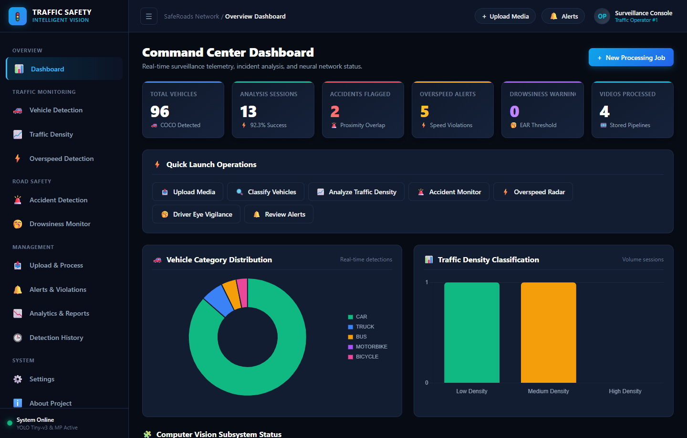

---

### 2. Vehicle Detection & Classification
*High-precision object localization and classification across COCO vehicle categories with confidence filtering and downloadable output.*
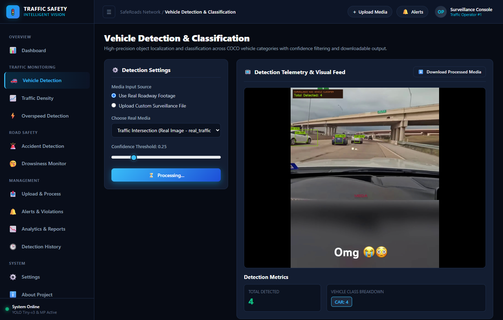

---

### 3. Traffic Density Analysis
*Rolling vehicle volume calculation, density classification (`Low`, `Medium`, `High`), automated congestion warnings, and interactive Chart.js density timelines.*
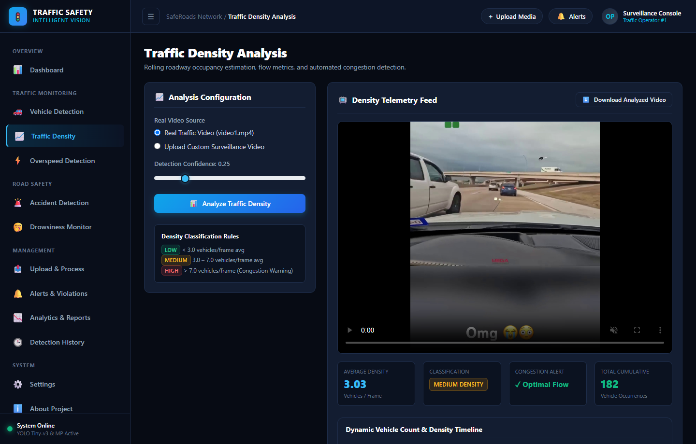

---

### 4. Overspeed Detection & Radar Telemetry
*Speed violation detection HUD with optical centroid velocity estimation and configurable speed limits.*
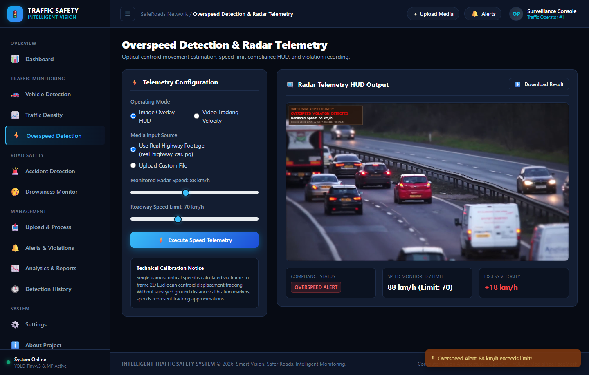

---

### 5. Accident Proximity & Collision Risk
*Spatial proximity overlap monitoring with multi-frame delayed confirmation state machine and incident snapshot capture.*
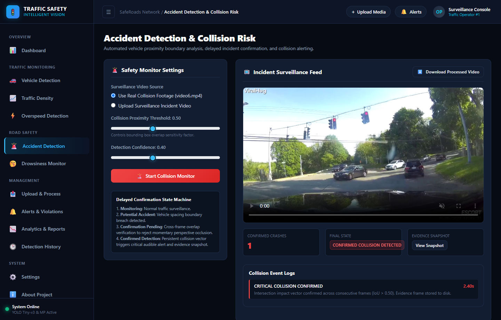

---

### 6. Driver Vigilance & Drowsiness Monitor
*Real-time Eye Aspect Ratio (EAR) computation from 468-point 3D facial landmark meshes, live webcam MJPEG streaming, and acoustic alarms.*
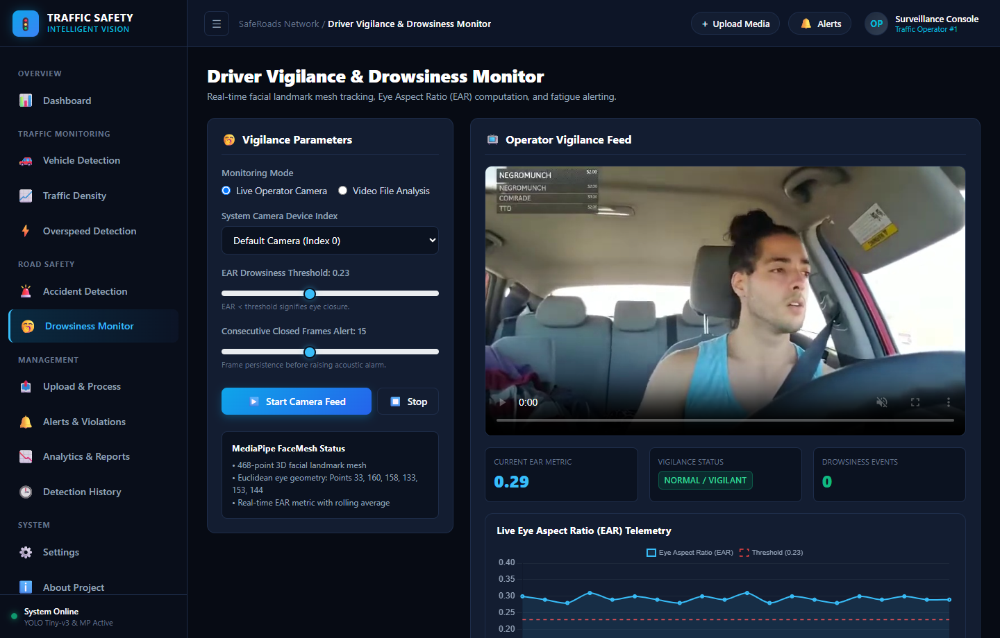

---

### 7. Central Video Upload & Processing Center
*Universal intake pipeline for processing surveillance video and imagery through computer vision neural networks with background job progress tracking.*
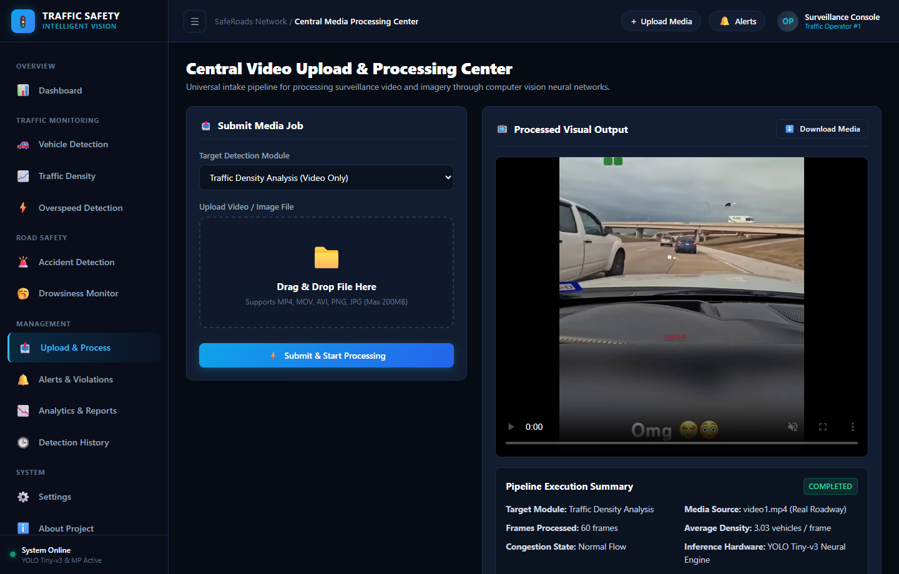

---

### 8. Safety Alerts & Incident Notifications
*Centralized management of roadway safety warnings, collision alerts, and driver vigilance events with severity filtering and resolution workflows.*
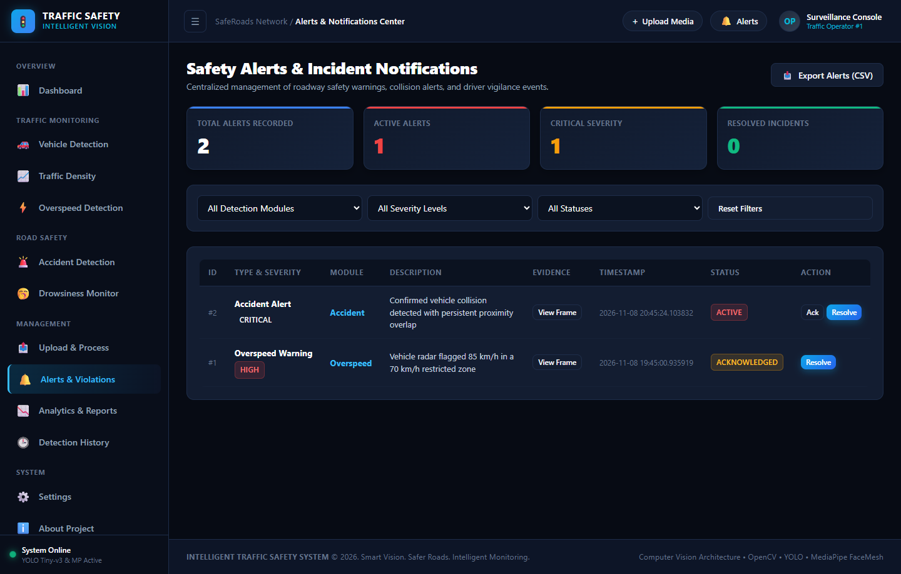

---

### 9. Analytics & Intelligence Reports
*Comprehensive statistical evaluations, distribution models, 8 interactive Chart.js visualizations, and 1-click exportable CSV reports.*
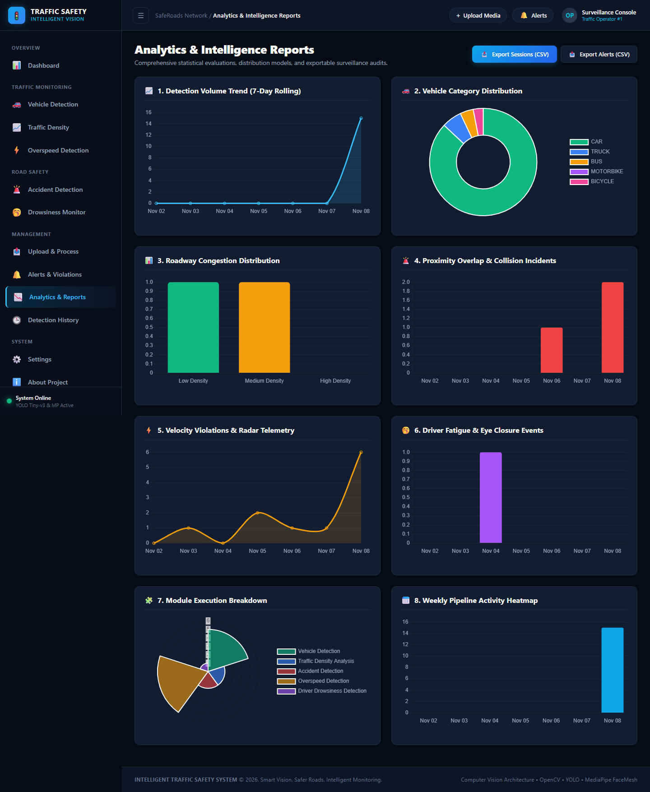

---

### 10. Detection History & Audit Log
*Permanent audit trail of all computer vision processing sessions, telemetry, and evidence files.*
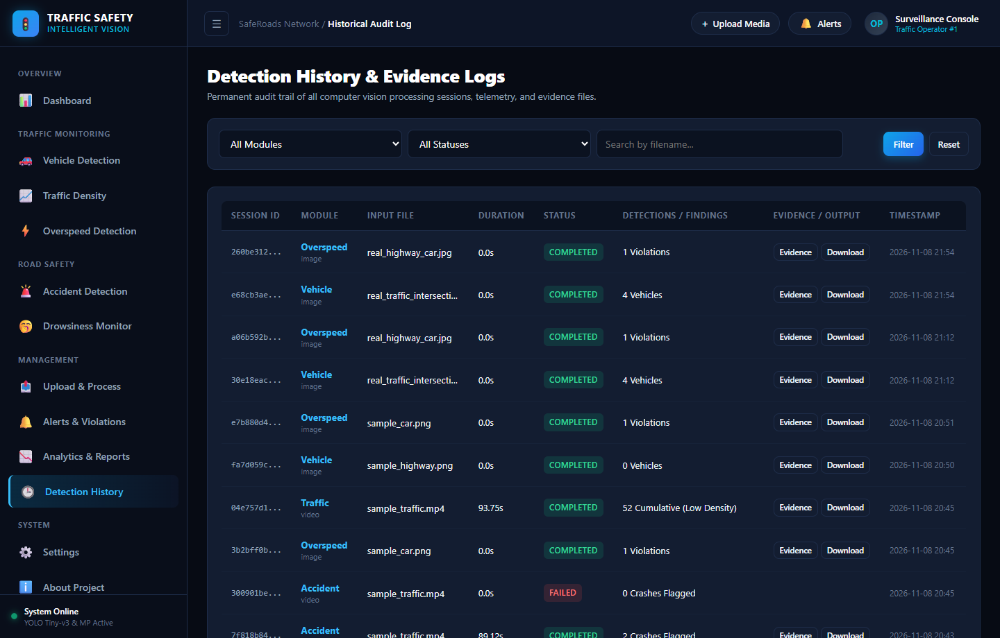

---

### 11. System Settings & Algorithm Thresholds
*Configure neural parameters, YOLO confidence, NMS suppression, collision proximity factors, and camera bindings.*
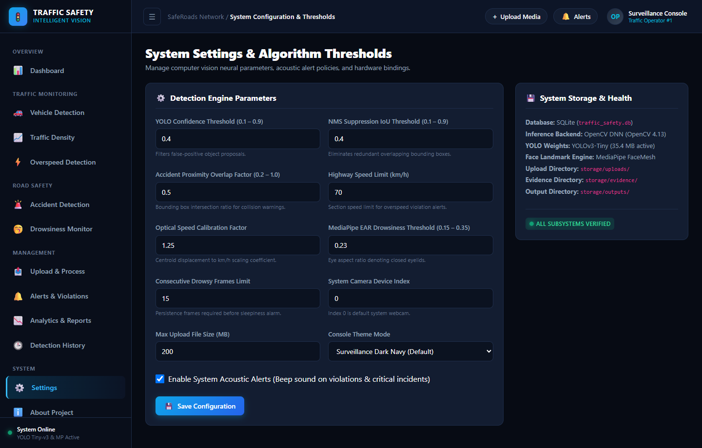

---

### 12. System Architecture & Methodology
*Comprehensive documentation, architectural dataflow steps, neural pipelines, and Phase 14 future enhancements roadmap.*
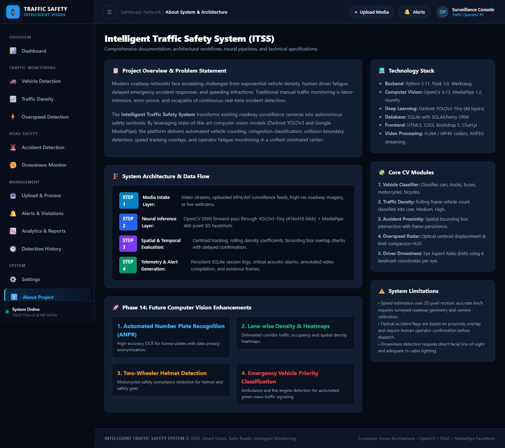

---

## 📐 System Architecture

```
Intelligent-Traffic-Safety-System/
├── app/
│   ├── __init__.py          # Flask app factory, DB initialization, Blueprints & media routes
│   ├── config.py            # Global configuration, upload limits, asset locations
│   ├── models/              # SQLite SQLAlchemy persistence models
│   │   ├── __init__.py
│   │   ├── session.py       # DetectionSession & ProcessingJob models
│   │   ├── alert.py         # Alert model (Critical, High, Medium, Low)
│   │   └── settings.py      # SystemSetting persistent configuration
│   ├── services/            # Background job management and data aggregators
│   │   ├── job_service.py   # Thread pool worker for non-blocking video jobs
│   │   ├── alert_service.py # Alert generation & lifecycle (Active/Ack/Resolved)
│   │   ├── stats_service.py # Real-time DB statistical aggregations
│   │   └── report_service.py# CSV report generators
│   ├── detection/           # Computer vision pipelines wrapping Darknet & MediaPipe
│   │   ├── base.py          # Shared YOLO singleton, asset locator, HUD boxes
│   │   ├── vehicle_detector.py   # Image & video vehicle detection and classification
│   │   ├── traffic_detector.py   # Traffic density calculation & congestion warning
│   │   ├── accident_detector.py  # Vehicle proximity collision & delayed confirmation
│   │   ├── overspeed_detector.py # Optical centroid speed estimation & HUD overlay
│   │   └── drowsiness_detector.py# 468-point FaceMesh Eye Aspect Ratio (EAR) & live stream
│   ├── routes/              # Dedicated Flask Blueprints for all 12 navigation pages
│   │   ├── dashboard.py     # Command center overview
│   │   ├── vehicle.py       # Vehicle detection module page
│   │   ├── traffic.py       # Traffic density analysis page
│   │   ├── overspeed.py     # Overspeed detection page
│   │   ├── accident.py      # Accident detection page
│   │   ├── drowsiness.py    # Driver drowsiness monitor (webcam & video)
│   │   ├── uploads.py       # Centralized media intake & processing
│   │   ├── alerts.py        # Safety alerts & notification management
│   │   ├── analytics.py     # Chart.js analytics & report downloads
│   │   ├── history.py       # Permanent detection audit log
│   │   ├── settings.py      # Persistent threshold settings
│   │   ├── about.py         # Architectural documentation
│   │   └── api.py           # REST API endpoints
│   ├── static/
│   │   ├── css/style.css    # Surveillance dark navy command center styling
│   │   └── js/              # Client-side job polling, AudioContext beeps, dropzones
│   └── templates/           # 12 Modular Jinja2 HTML templates
├── docs/
│   └── images/              # 12 High-resolution live application screenshots
├── data/                    # Sample media assets (sample_highway.png, sample_traffic.mp4, etc.)
├── sample_videos/           # Additional surveillance video test samples
├── storage/                 # Local filesystem storage for uploads, outputs, and evidence
│   ├── uploads/
│   ├── outputs/
│   └── evidence/
├── run.py                   # Central Flask server runner
├── main.py                  # CLI & platform launcher
├── requirements.txt         # Verified Python dependencies
├── coco.names               # COCO dataset class labels
├── yolov3-tiny.cfg          # YOLOv3-Tiny architecture
└── yolov3-tiny.weights      # Trained neural weights (35.4 MB)
```

---

## 🚦 Core Computer Vision Modules

- `traffic.py`: Traffic density detection using YOLO object detection.
- `accident.py`: Accident detection with delayed confirmation and alert display.
- `vehicle_name.py`: Vehicle detection and object name display on images or videos.
- `overspeed.py`: Speed overlay and warning message for images or videos.
- `drowsiness.py`: Driver drowsiness detection from camera or video.
- `app.py`: Browser-based dashboard for running individual modules.
- `download_assets.py`: Download the YOLO asset files required to run the object detection modules.

### Detailed Detection Capabilities:
1. **Vehicle Detection & Classification (`/vehicle/`)**:
   - Executes Darknet YOLOv3 neural detection on images and videos.
   - Categorizes vehicles (`car`, `truck`, `bus`, `motorbike`, `bicycle`, `person`).
   - Confidence scores, per-class distribution badges, annotated visual output, and downloadable media.

2. **Traffic Density Analysis (`/traffic/`)**:
   - Computes vehicle counts per frame and a cumulative rolling average density.
   - Categorizes roadway congestion using verified thresholds:
     - **Low Density**: `< 3.0` vehicles/frame.
     - **Medium Density**: `3.0 - 7.0` vehicles/frame.
     - **High Density**: `> 7.0` vehicles/frame (triggers automated congestion warnings).
   - Renders an interactive Chart.js density timeline.

3. **Accident Detection with Delayed Confirmation (`/accident/`)**:
   - Calculates spatial proximity and bounding box overlap vectors between vehicle pairs.
   - Implements a state-machine delayed confirmation filter across consecutive frames to eliminate momentary perspective crossings.
   - States: `Monitoring` &rarr; `Potential Accident` &rarr; `Confirmation Pending` &rarr; `Confirmed Detection`.
   - Automatically logs a **Critical Alert** with high-resolution evidence snapshots.

4. **Overspeed Detection & Radar Telemetry (`/overspeed/`)**:
   - **Image Mode**: Overlays configurable section speed limits and vehicle telemetry HUDs.
   - **Video Tracking Mode**: Employs 2D Euclidean centroid displacement tracking across frames.
   - *Technical Notice*: Single-camera optical flow serves as a relative velocity estimation and clearly notes the need for surveyed 3D road calibration for legal enforcement.

5. **Driver Vigilance & Drowsiness Monitor (`/drowsiness/`)**:
   - Leverages Google MediaPipe 468-point 3D FaceMesh to calculate Eye Aspect Ratio (EAR):
     $$\text{EAR} = \frac{\|p_1 - p_5\| + \|p_2 - p_4\|}{2 \times \|p_0 - p_3\|}$$
   - Eye Landmark indices: Left `[33, 160, 158, 133, 153, 144]`, Right `[362, 385, 387, 263, 373, 380]`.
   - Generates live MJPEG browser webcam streaming, real-time EAR telemetry graphing, and acoustic alarms when consecutive closed frames exceed threshold.

---

## 💻 Installation & Setup

### Prerequisites
- Python 3.10 or 3.11
- Windows, Linux, or macOS

### 1. Clone & Navigate to Repository
```bash
git clone https://github.com/nayanaastakar/Intelligent-Traffic-Safety-System.git
cd Intelligent-Traffic-Safety-System
```

### 2. Install Dependencies
```bash
python -m pip install -r requirements.txt
```

### 3. Verify YOLO Assets
Ensure the YOLO weights and configuration are present in the root folder:
- `yolov3-tiny.weights`
- `yolov3-tiny.cfg`
- `coco.names`

If missing, download them automatically with:
```bash
python download_assets.py
```

---

## 🚀 Running the Application

### Launch the Complete Web Platform
```bash
python run.py
```
Or use the application launcher:
```bash
python main.py
```
Open your browser and navigate to:
```
http://127.0.0.1:5000
```

### Run Standalone CLI Modules (Legacy Compatible)
Each original module remains 100% executable independently:
```bash
# Vehicle Detection on image
python main.py vehicle --image data/sample_highway.png

# Traffic Density on video
python main.py traffic --video data/sample_traffic.mp4

# Accident Detection on video
python main.py accident --video data/sample_traffic.mp4

# Overspeed Overlay
python main.py overspeed --image data/sample_car.png --speed 85

# Drowsiness Monitor via webcam
python main.py drowsiness
```

---

## 📡 REST API Documentation

| Endpoint | Method | Description |
|---|---|---|
| `/api/dashboard/stats` | `GET` | Aggregated surveillance telemetry, vehicle counts, and session metrics |
| `/api/modules/status` | `GET` | Availability and last execution timestamps for all 5 CV engines |
| `/api/vehicle/detect` | `POST` | Execute vehicle classification on uploaded or sample image/video |
| `/api/traffic/analyze` | `POST` | Queue a traffic density analysis job |
| `/api/accident/detect` | `POST` | Queue collision proximity monitoring job |
| `/api/overspeed/detect`| `POST` | Execute speed telemetry or video tracking job |
| `/api/jobs/<job_id>` | `GET` | Poll background video processing progress (0-100%) |
| `/api/jobs/<job_id>/result` | `GET` | Retrieve finished session findings and output references |
| `/api/alerts` | `GET` | List persisted alerts with module and severity filters |
| `/api/alerts/<id>` | `PATCH` | Update alert status (`Active`, `Acknowledged`, `Resolved`) |
| `/api/history` | `GET` | Retrieve chronological session records |
| `/analytics/export/sessions.csv` | `GET` | Download full processing sessions CSV report |
| `/analytics/export/alerts.csv` | `GET` | Download safety alerts CSV report |
| `/drowsiness/stream` | `GET` | Live multipart MJPEG webcam stream with MediaPipe landmarks |

---

## 📱 Responsive Design & Cross-Device Support

The platform features a fully responsive architecture optimized across smartphones, tablets, laptops, and ultra-wide surveillance video walls:

- **Mobile Navigation Drawer**: Slide-out offcanvas navigation on screens `< 992px` featuring a translucent backdrop blur and a dedicated close button.
- **Adaptive Topbar**: Compact command header that collapses long breadcrumb hierarchies and preserves touch targets for quick media upload, alert triage, and operator status.
- **Fluid Metric Grids**: KPI summary metrics automatically reflow into a clean 2-column layout on phones (`col-6 col-md-4 col-xl-2`), preventing excessive vertical scrolling.
- **Touch-Friendly Controls**: Enlarged range slider thumbs, full-width submission triggers, and mobile-optimized drag-and-drop dropzones.
- **Responsive Telemetry & Charts**: Chart.js canvases auto-scale fluidly across device widths with responsive legend placements and horizontally scrollable data tables (`.table-responsive`).

---

## 🔒 Security & Reliability
- **Controlled File Delivery**: Internal server paths are masked behind `/media/<path>`, guarded against path traversal.
- **Background Processing**: Video processing runs inside isolated thread pools so web requests never freeze.
- **Persistent SQLite Storage**: No data is lost upon server restart.
- **Safe Audio Handling**: Graceful fallback between Windows `winsound` and Web Audio API synthesize beeps.

---

## 📜 License
Educational and research project developed for Intelligent Transportation Systems and Roadway Safety Surveillance.
